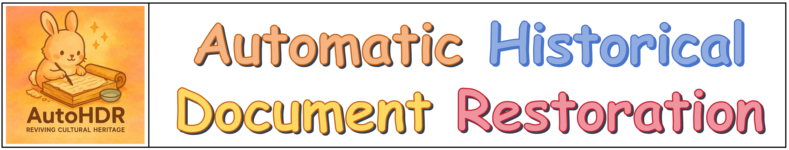
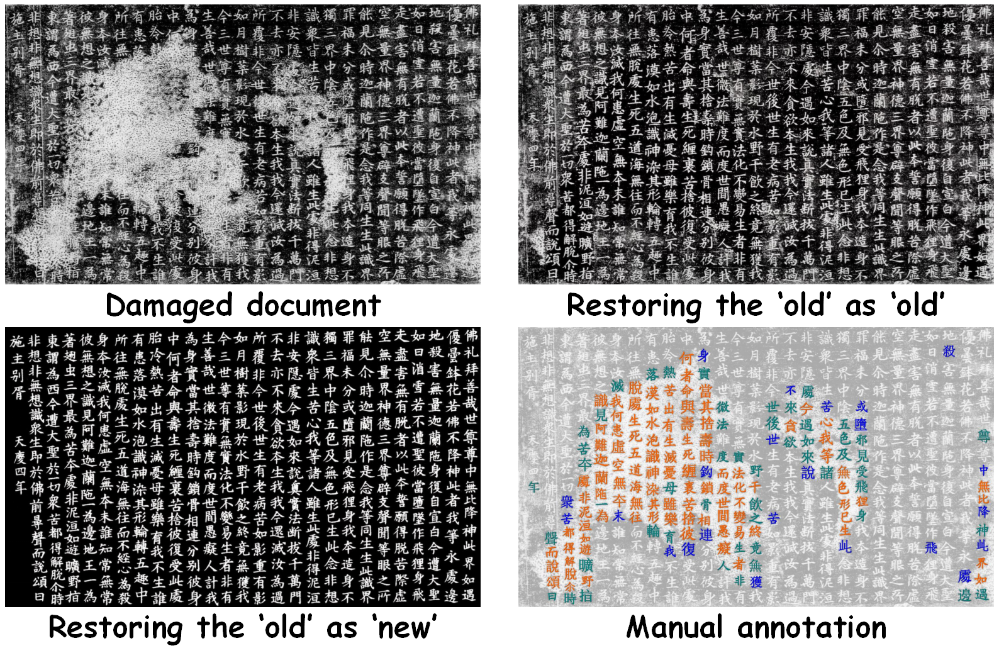
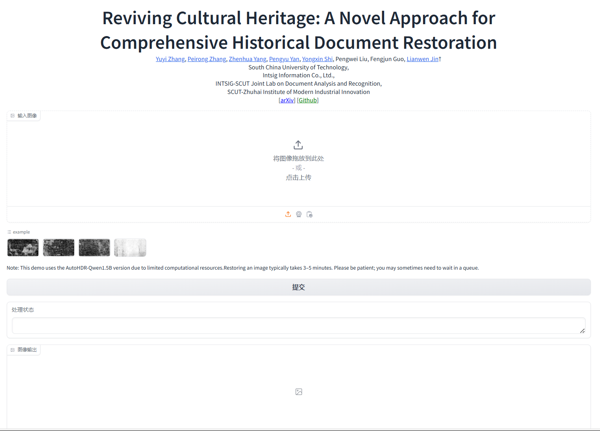

<div align="center">

# Reviving Cultural Heritage：面向历史文档全面修复的新方法

[English](README.md) | **简体中文**

</div>



<div align="center">

[](https://arxiv.org/abs/2507.05108)
[](http://121.41.49.212:8432/)
[](https://github.com/ZZXF11)
[](http://dlvc-lab.net/lianwen/)
[](https://github.com/SCUT-DLVCLab/AutoHDR)

</div>

## 重要说明

本数据集的原始数据来自互联网等公开渠道，相关版权归原始提供方所有。本项目整理并标注的数据集仅限非商业用途，目前仅向高校及科研机构授权。若需申请使用，请按照数据集官方网站的要求填写相应申请材料。

申请人须为高校或科研机构的全职工作人员，并须在申请表上签字。为方便审核，建议加盖单位公章（二级部门公章亦可）。

## 🌟 项目亮点

- AutoHDR


- FPHDR 数据集



- 我们提出了一套全自动历史文档修复方案 **AutoHDR**，其设计灵感来自历史学专家的实际修复流程。
- 我们构建了首个全页历史文档修复数据集 **FPHDR**，可用于全面的历史文档修复模型训练与评测。
- 大量实验表明，本方法在文字内容与文档外观修复方面均具有优越性能。
- 模块化设计支持灵活调整，使 AutoHDR 能够更有效地与历史学专家协作。

## 📅 最新动态

- **2026.07.15**：🎉 我们提出了用于端到端历史铭文修复的统一多模态大模型 [UniHIR](https://aclanthology.org/2026.acl-long.1254/)。
- **2025.07.21**：📢 FPHDR 数据集正式发布！
- **2025.07.17**：🚀 预训练[模型](#-模型库)已发布！
- **2025.07.13**：🔥🎉 在线 💻 [Demo](http://121.41.49.212:8432/) 已上线，欢迎体验！
- **2025.07.09**：发布推理代码。
- **2025.07.08**：论文已发布至 [arXiv](https://arxiv.org/abs/2507.05108)。
- **2025.05.15**：🎉🎉 论文被 ACL 2025 Main 接收。

## 🚧 待办事项

- [x] 发布推理代码
- [x] 发布预训练模型
- [x] 发布 [WebUI](http://121.41.49.212:8632/)
- [x] 发布数据集
- [ ] 将预训练模型上传至 Hugging Face

## 🔥 模型库

| **模型** | **权重下载** | **状态** |
|---|---|---|
| **AutoHDR-Qwen2-1.5B** | [百度网盘：W2wq](https://pan.baidu.com/s/1j_HmyNDG0dOD6TyBHvqYwQ?pwd=W2wq) | 已发布 |
| **AutoHDR-Qwen2-7B** | [百度网盘：6o84](https://pan.baidu.com/s/1CUREGQIBoed1BgHjELguTQ?pwd=6o84) | 已发布 |
| **DiffHDR** | [百度网盘：63a3](https://pan.baidu.com/s/1fSKd5uQsiKp2uPQBdKtC3Q?pwd=63a3) | 已发布 |
| **损伤定位模型** | [百度网盘：2QC7](https://pan.baidu.com/s/1wGcT6Ktzqg_bOyc8NsV4Ig?pwd=2QC7) | 已发布 |
| **OCR 模型** | [百度网盘：1X88](https://pan.baidu.com/s/1GfNQKIJ17Yf6QSv-dCaPEQ?pwd=1X88) | 已发布 |

## 🔥 FPHDR 数据集

| **数据集** | **下载链接** | **状态** |
|---|---|---|
| 真实数据 | [百度网盘：ryk3](https://pan.baidu.com/s/1zpS4B3E0eZJ9Hza-HxpX4w?pwd=ryk3) | 已发布 |
| 合成数据 | [百度网盘：qzsv](https://pan.baidu.com/s/1bqoddr-1NCF1D8H_xjQAXA?pwd=qzsv) | 已发布 |

**说明：**

- FPHDR 数据集仅限非商业科研用途。研究人员或机构可通过在线平台提交申请：👉 [点击申请](http://121.41.49.212:9000/)

  提交申请时，请列出或附上近 6 年内的 1–2 篇论文，以说明您或您的团队从事 OCR、历史文档分析与修复、文档图像处理等相关研究。

- 申请通过审核后，我们将提供数据集解压密码。
- 所有用户均须遵守使用条件，否则授权将被撤销。

<details>
<summary><b>数据集文件结构</b></summary>

```plaintext
images/
  ├── FS_2_2_1.jpg
  ├── FS_2_9_1.jpg
  ├── ...
labels/
  ├── FS_2_2_1.json
  ├── FS_2_9_1.json
  ├── ...
```

</details>

<details>
<summary><b>标注格式</b></summary>

```json
{
  "columns": [
    {
      "x": ...,
      "y": ...,
      "w": ...,
      "h": ...,
      "column_id": "...",
      "idx": ...
    },
    ...
  ],
  "chars": [
    {
      "x": ...,
      "y": ...,
      "w": ...,
      "h": ...,
      "txt": "...",
      "cid": ...,
      "char_id": "...",
      "idx": ...,
      "grade": "light|medium|severe|null"
    },
    ...
  ]
}
```

- `columns`：文本列的边界框，格式为 `(x, y, w, h)`。
- `chars`：字符级标注，包括 `txt`、`x`、`y`、`w`、`h` 和 `grade`。
- `grade`：损伤程度，包括 `light`（轻度）、`medium`（中度）、`severe`（重度）；未损伤字符为空。

</details>

## 🚧 安装

### 环境要求

- **Ubuntu 20.04**（必需）
- Linux
- Python 3.10
- PyTorch 2.3.0
- CUDA 11.8

### 环境配置

克隆本仓库：

```bash
git clone https://github.com/SCUT-DLVCLab/AutoHDR.git
```

**步骤 0**：从 [Miniconda 官方网站](https://docs.conda.io/en/latest/miniconda.html)下载并安装 Miniconda。

**步骤 1**：创建并激活 Conda 环境。

```bash
conda create -n autohdr python=3.10 -y
conda activate autohdr
```

**步骤 2**：安装依赖。

```bash
pip install -r requirements.txt
```

## 📺 推理

**步骤 0**：从[模型库](#-模型库)下载除 OCR 模型以外的全部模型文件，并将其放入 `ckpt` 文件夹。

**步骤 1**：从[模型库](#-模型库)下载 OCR 模型文件，解压后将文件移入 `dist` 文件夹。

**步骤 2**：使用 AutoHDR 修复受损历史文档：

```bash
CUDA_VISIBLE_DEVICES=<gpu_id> python infer_pipeline.py
```

## 🚀 运行 WebUI

我们提供两种便捷的 WebUI 使用方式：

**方式 1：** 直接访问在线 [Demo](http://121.41.49.212:8432/)。

**方式 2：** 在本地运行：

```bash
CUDA_VISIBLE_DEVICES=<gpu_id> python demo_gradio.py
```

示例：



## ☎️ 联系方式

如有任何问题，欢迎通过 [yuyi.zhang11@foxmail.com](mailto:yuyi.zhang11@foxmail.com) 联系 [Yuyi Zhang](https://github.com/ZZXF11)。

## 🌄 效果展示


## 💙 致谢

- [mmdetection](https://github.com/open-mmlab/mmdetection)
- [Qwen](https://github.com/QwenLM/Qwen3)
- [DiffHDR](https://github.com/yeungchenwa/HDR)
- [diffusers](https://github.com/huggingface/diffusers)
- [HisDoc1B](https://github.com/SCUT-DLVCLab/HisDoc1B)
- [MegaHan97K](https://github.com/SCUT-DLVCLab/MegaHan97K)

## 📜 许可证

代码和数据集仅限非商业科研用途，并应遵循 [CC BY-NC-ND 4.0](https://creativecommons.org/licenses/by-nc-nd/4.0/) 许可协议使用和分发。

## ⛔️ 版权声明

- 本仓库仅限非商业科研用途。
- 如需商业使用，请联系金连文教授（eelwjin@scut.edu.cn）。
- Copyright 2025，[华南理工大学深度学习与视觉计算实验室（DLVC-Lab）](http://www.dlvc-lab.net)。

## ✒️ 引用

如果 AutoHDR 对您的研究有所帮助，欢迎为本项目点亮 ⭐ 并引用：

```bibtex
@article{Zhang2025autohdr,
      title={Reviving Cultural Heritage: A Novel Approach for Comprehensive Historical Document Restoration},
      author={Yuyi Zhang and Peirong Zhang and Zhenhua Yang and Pengyu Yan and Yongxin Shi and Pengwei Liu and Fengjun Guo and Lianwen Jin},
      journal={Proceedings of the 63rd Annual Meeting of the Association for Computational Linguistics},
      year={2025},
}
```

感谢您的支持！
